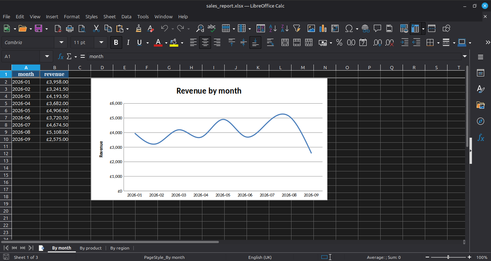

# Excel Report Generator

A command-line tool that turns a sales CSV into a formatted Excel report, so nobody has to build the same summary tables and charts by hand every month.

```bash
python make_report.py sample_data/sales.csv sales_report.xlsx
```

## What it produces

An Excel workbook with three sheets: revenue **by month**, **by product** and **by region**. Each sheet has a styled header row, money formatted as pounds, columns sized to fit their contents, and a chart next to the table.



For the sample data (400 orders), the report totals £36,059.00 in revenue. The summaries are checked against each other: every table adds up to that same total.

## What it does with messy data

- Stops with a clear message if the file is missing, empty, or lacks a required column (`order_id`, `date`, `region`, `product`, `quantity`, `unit_price`)
- Skips rows with an unreadable date, quantity or price, and says how many it skipped
- Won't overwrite a report that is open in another program, and says so instead of crashing

## How to run

```bash
git clone git@github.com:playfu1-d0ubt/excel-report-generator.git
cd excel-report-generator
python3 -m venv venv
source venv/bin/activate
pip install -r requirements.txt

python make_sample_data.py
python make_report.py sample_data/sales.csv sales_report.xlsx
```

Use `python make_report.py --help` to see the options. To use your own data, give it a CSV with the six columns listed above.

## Files

| File | Purpose |
|---|---|
| `make_report.py` | Reads the CSV, builds the summaries, writes the Excel report |
| `make_sample_data.py` | Generates a fake sales CSV (400 orders, same data every time) |
| `sample_data/sales.csv` | The generated sample data. It is fake, with no real customer data |

## How it works

1. **pandas** loads the CSV, calculates revenue per order, and groups it by month, product and region.
2. **openpyxl** writes each summary to its own sheet, formats it, and adds a line chart (by month) or bar chart (by product and region).
3. The header row has a fixed fill with white text. Data cells leave the font colour unset, so the text adapts to dark mode instead of staying dark on a dark background.

## Limitations

- The sample data runs from January to the end of September, so September is a partial month and shows as a dip on the chart. It isn't a real drop in sales.
- It expects exactly the column names listed above. Files with different names need renaming first.
- It only produces revenue summaries, with no filtering by date range and no comparison between periods.
- I haven't tested it in Microsoft Excel. The report was checked in LibreOffice Calc on Linux Mint.
- The charts' text may not adapt to dark mode the way the cell text does.

## What I learned

- How to build formatted Excel files from Python with openpyxl: styles, number formats, frozen headers and charts.
- Checking my numbers against each other (each table adding up to the same total) catches mistakes before they reach a report.
- Reading and checking input properly (missing files, missing columns, bad rows) takes more code than the actual analysis, but it's what makes a tool usable by someone else.
- Setting a font colour explicitly stops text adapting to dark mode. I found that out because the first version was unreadable in my own dark theme.